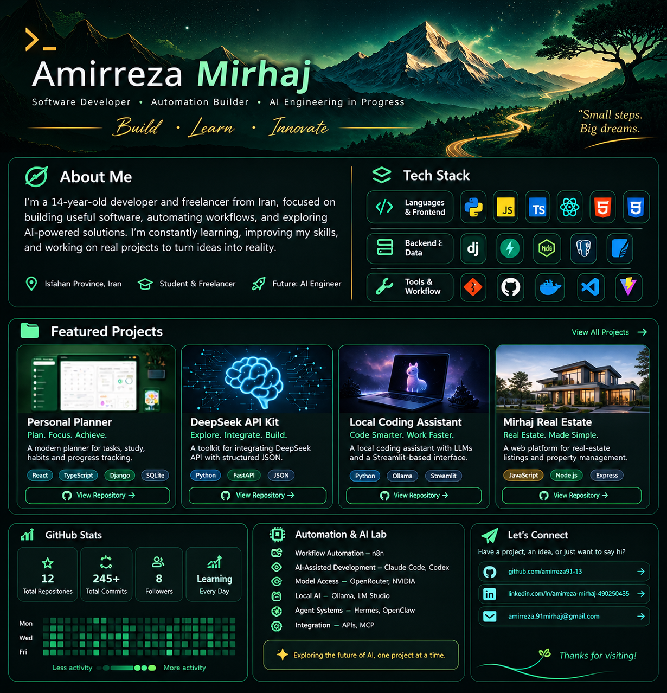

<!-- Profile README: forest green / electric mint visual system -->

<div align="center">


# Amirreza Mirhaj

### Software Development · Workflow Automation · AI Engineering

I build practical software, automate repetitive workflows, and explore how AI can make developer tools more useful.

<p>
  <a href="https://github.com/amirreza91-13">
    
  </a>
  <a href="https://www.linkedin.com/in/amirreza-mirhaj-490250435/">
    
  </a>
  <a href="https://x.com/amirrezaPG">
    
  </a>
</p>



</div>

---

## About

I'm an independent builder focused on learning by shipping real projects. My current work combines web development, API integration, workflow automation, and experiments with AI-powered tools.

- **Building:** browser utilities and practical web applications.
- **Automating:** workflows and service integrations with n8n.
- **Exploring:** model APIs, local LLM tools, and AI-assisted development.
- **Developing toward:** AI Engineering, with software fundamentals as the foundation.

I distinguish between what a project currently does and what I plan to build next. Project status and limitations are documented in the repositories.

## Selected Projects

A short list of projects that show different parts of my work.

<table>
  <tr>
    <td width="50%" valign="top">
      <h3><a href="https://github.com/amirreza91-13/devflow-kit">01 · DevFlow Kit</a></h3>
      <a href="https://github.com/amirreza91-13/devflow-kit">
        
      </a>
      <p>A privacy-first collection of 13 browser-based utilities for common developer tasks. Built with vanilla JavaScript, Web APIs, and automated tests.</p>
      <sub><strong>Stack:</strong> JavaScript · HTML · CSS · Web Workers · Node.js</sub>
      <br/>
      <a href="https://github.com/amirreza91-13/devflow-kit/actions/workflows/validate.yml">CI workflow</a> ·
      <a href="https://github.com/amirreza91-13/devflow-kit">Source code</a>
    </td>
    <td width="50%" valign="top">
      <h3><a href="https://github.com/amirreza91-13/mirhaj-realestate">02 · Mirhaj Real Estate</a></h3>
      <a href="https://github.com/amirreza91-13/mirhaj-realestate">
        
      </a>
      <p>A real-estate application project with property workflows, an Express server, authentication routes, database integration, and real-time features.</p>
      <sub><strong>Stack:</strong> Node.js · Express · JavaScript · Socket.IO · sql.js</sub>
      <br/>
      <a href="https://github.com/amirreza91-13/mirhaj-realestate">Source code and security notes</a>
    </td>
  </tr>
  <tr>
    <td width="50%" valign="top">
      <h3><a href="https://github.com/amirreza91-13/planner">03 · Planner</a></h3>
      <a href="https://github.com/amirreza91-13/planner">
        
      </a>
      <p>A bilingual Persian/English planning app with tasks, habits, calendar, notes, focus timer, and reports. Frontend/backend integration remains in progress.</p>
      <sub><strong>Stack:</strong> React · TypeScript · Vite · Python · Django · SQLite</sub>
      <br/>
      <a href="https://github.com/amirreza91-13/planner">Source code and feature status</a>
    </td>
    <td width="50%" valign="top">
      <h3><a href="https://github.com/amirreza91-13/Local-Coding-Assistant">04 · Local Coding Assistant</a></h3>
      <a href="https://github.com/amirreza91-13/Local-Coding-Assistant">
        
      </a>
      <p>An experimental Python coding assistant with terminal and Streamlit interfaces, connecting to locally hosted models through Ollama.</p>
      <sub><strong>Stack:</strong> Python · Streamlit · Ollama</sub>
      <br/>
      <a href="https://github.com/amirreza91-13/Local-Coding-Assistant">Source code and limitations</a>
    </td>
  </tr>
</table>

## Technology Stack

Technologies are grouped by where they fit in my current work. The icons are visual references, not claims of equal proficiency.

### Languages

<p>
  
</p>

### Frameworks, Runtime & Data

<p>
  
</p>

### Developer Tools

<p>
  
</p>

### AI & Automation

<p>
  <a href="https://n8n.io/"></a>
  <a href="https://ollama.com/"></a>
  <a href="https://openrouter.ai/"></a>
  <a href="https://lmstudio.ai/"></a>
  <a href="https://www.anthropic.com/claude-code"></a>
  <a href="https://openai.com/codex/"></a>
  <a href="https://opencode.ai/"></a>
</p>

## Current Direction

```text
Software Engineering
        ↓
APIs & Backend Fundamentals
        ↓
Workflow Automation
        ↓
Practical AI Applications
        ↓
Agents, Machine Learning & AI Engineering
```

My priorities are to strengthen Python and software engineering fundamentals, improve testing and debugging, build reliable integrations, and turn AI experiments into useful applications.

## GitHub Activity

<div align="center">
  
  
</div>

<p align="center"><sub>Stats are provided by an external service and may be delayed. Repository language percentages do not measure proficiency.</sub></p>

---

<div align="center">

<sub>Build with purpose. Document the process. Improve through iteration.</sub>

</div>
