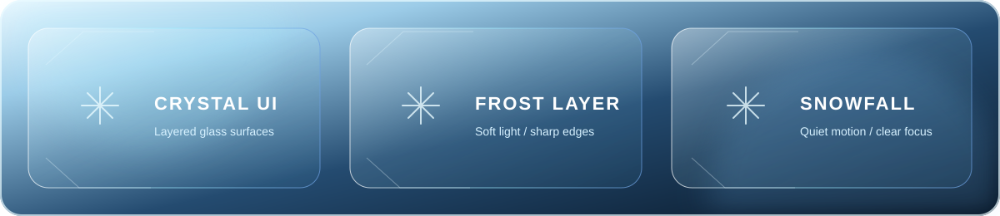
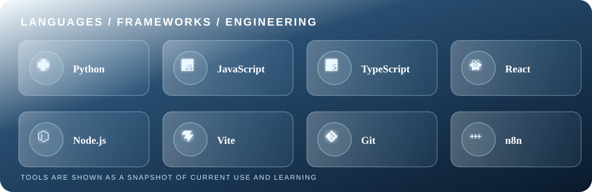
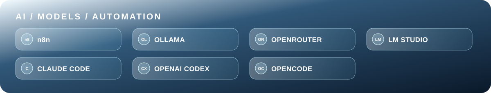

<!-- FROSTBYTE / Profile README. Artwork is stored locally in this repository. -->

<div align="center">


# Amirreza Mirhaj

### Software Development · Workflow Automation · Applied AI

I build practical software, connect systems, and explore applied AI through implementation, testing, and continuous learning.

<p>
  <a href="https://github.com/amirreza91-13"></a>
  &nbsp;&nbsp;
  <a href="https://www.linkedin.com/in/amirreza-mirhaj-490250435/"></a>
  &nbsp;&nbsp;
  <a href="https://x.com/amirrezaPG"></a>
  &nbsp;&nbsp;
  <a href="mailto:amirreza.91mirhaj@gmail.com"></a>
  &nbsp;&nbsp;
  <a href="https://t.me/AmirrezaMirhajAIBot"></a>
</p>

[EXPLORE REPOSITORIES](https://github.com/amirreza91-13?tab=repositories)
&nbsp; ◇ &nbsp;
[VIEW CONTRIBUTIONS](https://github.com/amirreza91-13?tab=overview)
&nbsp; ◇ &nbsp;
[OPEN SOURCE PROJECTS](https://github.com/amirreza91-13?tab=repositories)

</div>

---

## ❄️ The Frostbyte interface



A visual identity built around **frosted glass, crystalline edges, cold light, and restrained electric-blue accents**. The artwork is stored in this repository so the profile does not depend on third-party image hosts.

## ◈ Engineering focus

| Focus | What I work on |
|:--|:--|
| **Software development** | Browser-based utilities, web applications, and programming fundamentals |
| **Workflow automation** | APIs, service integrations, webhooks, and repeatable workflows |
| **Applied AI** | Model APIs, local model experiments, and AI-assisted developer workflows |
| **Engineering practice** | Testing, debugging, documentation, maintainability, and security awareness |

I keep implemented functionality separate from planned work. Project-specific limitations and development status belong in each repository's documentation.

## ⚡ Featured projects

<table>
  <tr>
    <td width="50%" valign="top">
      <h3><a href="https://github.com/amirreza91-13/devflow-kit">01 / DevFlow Kit</a></h3>
      <a href="https://github.com/amirreza91-13/devflow-kit"></a>
      <p>A privacy-first workspace with 13 browser-based utilities for everyday developer tasks. Built without an application backend or account system.</p>
      <sub>JavaScript · HTML · CSS · Web APIs · Web Workers</sub>
      <br/>
      <a href="https://github.com/amirreza91-13/devflow-kit/actions">CI workflows</a> · <a href="https://github.com/amirreza91-13/devflow-kit">Source code</a>
    </td>
    <td width="50%" valign="top">
      <h3><a href="https://github.com/amirreza91-13/mirhaj-realestate">02 / Mirhaj Real Estate</a></h3>
      <a href="https://github.com/amirreza91-13/mirhaj-realestate"></a>
      <p>A full-stack real-estate application project covering property workflows, server routes, authentication, database access, uploads, and real-time events.</p>
      <sub>Node.js · Express · JavaScript · sql.js · Socket.IO</sub>
      <br/>
      <a href="https://github.com/amirreza91-13/mirhaj-realestate">Source code & security notes</a>
    </td>
  </tr>
  <tr>
    <td width="50%" valign="top">
      <h3><a href="https://github.com/amirreza91-13/planner">03 / Planner</a></h3>
      <a href="https://github.com/amirreza91-13/planner"></a>
      <p>A Persian/English planning application for tasks, habits, calendar, notes, focus sessions, and reports. Frontend/backend integration is still in progress.</p>
      <sub>React · TypeScript · Vite · Python · Django · SQLite</sub>
      <br/>
      <a href="https://github.com/amirreza91-13/planner">Source code & development status</a>
    </td>
    <td width="50%" valign="top">
      <h3><a href="https://github.com/amirreza91-13/Local-Coding-Assistant">04 / Local Coding Assistant</a></h3>
      <a href="https://github.com/amirreza91-13/Local-Coding-Assistant"></a>
      <p>An experimental Python assistant with terminal and Streamlit interfaces, connecting to locally hosted models through Ollama.</p>
      <sub>Python · Streamlit · Ollama · Local LLMs</sub>
      <br/>
      <a href="https://github.com/amirreza91-13/Local-Coding-Assistant">Source code & limitations</a>
    </td>
  </tr>
</table>

## 🧊 Project matrix

| Project | Domain | Current stage |
|:--|:--|:--|
| [DevFlow Kit](https://github.com/amirreza91-13/devflow-kit) | Developer utilities | Public project · automated validation |
| [Mirhaj Real Estate](https://github.com/amirreza91-13/mirhaj-realestate) | Full-stack web application | Active development |
| [Planner](https://github.com/amirreza91-13/planner) | Personal productivity | In development |
| [Local Coding Assistant](https://github.com/amirreza91-13/Local-Coding-Assistant) | Local AI experimentation | Experimental |

## 💠 Technology constellation

The local vector panels below are a snapshot of technologies used, explored, or currently being learned — **not a proficiency ranking**.





<details>
  <summary><strong>Explore the wider toolbox</strong></summary>

  **Languages & web:** Python · JavaScript · TypeScript · HTML · CSS

  **Frameworks & data:** React · Vite · Node.js · Express · Django · SQLite · sql.js

  **Automation & AI:** n8n · Ollama · OpenRouter · LM Studio · Claude Code · OpenAI Codex · OpenCode

  **Developer workflow:** Git · GitHub · VS Code · PowerShell · API testing · documentation

</details>

## ⟡ How I approach building

<table>
  <tr>
    <td align="center" width="25%"><strong>01</strong><br/>Understand</td>
    <td align="center" width="25%"><strong>02</strong><br/>Design</td>
    <td align="center" width="25%"><strong>03</strong><br/>Build & test</td>
    <td align="center" width="25%"><strong>04</strong><br/>Document</td>
  </tr>
</table>

- Prefer useful features over decorative complexity.
- Keep dependencies and external services intentional.
- Test important paths and document known limitations.
- Improve through small, verifiable iterations.

## ❄️ Current learning direction

```text
Software Engineering Foundations
             │
             ▼
       Workflow Automation
             │
             ▼
       Practical AI Systems
             │
             ▼
    Agents · ML · AI Engineering
```

Current priorities: strengthen Python and software engineering fundamentals, improve testing and debugging, build reliable integrations, and turn AI experiments into useful applications.

<details>
  <summary><strong>What I am improving right now</strong></summary>

  - Writing clearer, more maintainable code.
  - Understanding backend architecture, APIs, and data handling.
  - Building repeatable tests and debugging workflows.
  - Evaluating AI tools based on practical usefulness rather than hype.

</details>

---

<div align="center">

## CONNECT / COLLABORATE

<a href="mailto:amirreza.91mirhaj@gmail.com">EMAIL</a>
&nbsp; · &nbsp;
<a href="https://t.me/AmirrezaMirhajAIBot">TELEGRAM BOT</a>
&nbsp; · &nbsp;
<a href="https://www.linkedin.com/in/amirreza-mirhaj-490250435/">LINKEDIN</a>
&nbsp; · &nbsp;
<a href="https://x.com/amirrezaPG">X</a>
&nbsp; · &nbsp;
<a href="https://github.com/amirreza91-13">GITHUB</a>

<br/><br/>

<sub>BUILD WITH INTENT · TEST WITH CARE · IMPROVE CONTINUOUSLY</sub>

</div>
