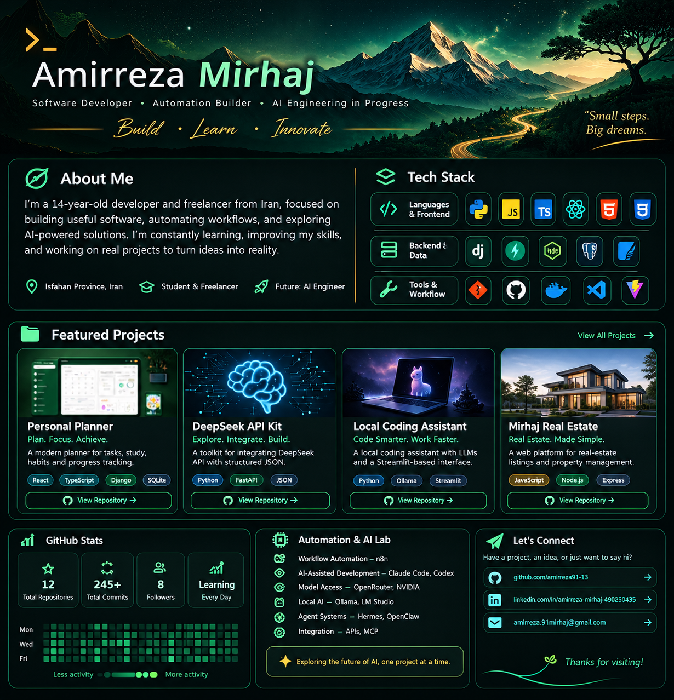

# Amirreza Mirhaj

### Teen Freelancer · Automation Builder · Aspiring AI Engineer

**Software Development · AI Workflows · LLM Integration**

  

I’m a teen freelancer interested in building practical software, automating repetitive tasks, and exploring how AI models and developer tools can work together.

My current focus is on Python, workflow automation, API integration, AI-assisted development, and building a strong foundation for my long-term goal of becoming an AI Engineer.

I believe in learning by building, documenting what I learn, and turning ideas into practical projects.

---

## About Me

* **Current role:** Freelance developer and automation builder.
* **Main interests:** Software development, AI workflows, APIs, and developer tooling.
* **Practical experience:** Building workflow automations, including form-to-Google-Sheets integrations with n8n.
* **AI exploration:** Experimenting with language models, model APIs, and tools for AI-assisted development.
* **Long-term goal:** Machine Learning and AI Engineering.

I’m continuously developing my skills through hands-on projects, structured learning, and technical experimentation.

## Workflow Automation

### n8n · Practical Workflow Design

I work with n8n to connect services and build practical automations that reduce repetitive manual work.

My hands-on experience includes:

* Building forms connected to Google Sheets.
* Connecting workflow steps and external services.
* Exploring API integrations and workflow logic.
* Developing my understanding of more advanced automation patterns.

**Current direction:** Expanding toward AI-powered workflows, more sophisticated integrations, and agent-based systems.

My focus is not just on connecting tools, but on understanding how to design workflows that solve real problems.

## AI & LLM Ecosystem

I explore language models and AI development tools to understand their capabilities, API requirements, and practical applications.

### Model APIs & Integration

* Experimenting with NVIDIA-hosted AI models and model APIs.
* Exploring different models and providers through OpenRouter.
* Working with API configuration, endpoints, and compatibility.
* Investigating how different model interfaces can connect with developer tools.

### Jan AI

I have explored Jan AI in the context of model access and API compatibility.

Jan provides API interfaces compatible with established formats, including OpenAI and Anthropic-compatible endpoints. Its exact compatibility depends on the endpoint, model, and integration being used.

The broader goal of this exploration is to understand how to connect different models to AI development tools without assuming that every provider or API is interchangeable.

### Prompt Design & Context Optimization

I’m interested in improving how instructions, context, and model interactions are structured to produce more useful and consistent results.

This includes experimentation with prompt design, context management, and AI-assisted development workflows.

## Technical Toolkit

The following represents my current toolkit and areas of practical exploration—not a claim of expert-level proficiency in every technology.

### Languages & Development

  

### Web & Backend Technologies

  

### Developer Tools & Platforms

  

### Automation & AI

  
  
  
  

Technology icons indicate tools and technologies in my learning and development environment. They should not be interpreted as evidence of advanced mastery.

## AI-Assisted Development & Agent Tooling

I explore tools that support coding, model interaction, and agent-based workflows.

### Tools I Have Used or Worked With

* **Claude Code** — AI-assisted coding and development workflows.
* **OpenCode** — exploring and using an open-source AI coding environment.
* **Jan AI** — model access and API compatibility experimentation.
* **OpenRouter** — experimenting with model providers and API access.
* **n8n** — practical workflow automation.

### Tools Under Exploration

* **Codex** — exploring AI-assisted software development.
* **Hermes Agent** — investigating agent workflows and capabilities.
* **OpenClaw** — exploring agent-based tooling and integrations.
* **Agent Router concepts** — investigating how model and agent routing can be designed.

My experience varies by tool. I distinguish between tools I have used directly and technologies I am still evaluating or learning.

## Current Focus

My current learning and development priorities include:

* Improving Python and software development fundamentals.
* Building more reliable API integrations.
* Advancing my practical n8n automation skills.
* Exploring AI-powered workflows and agent architectures.
* Improving Git, GitHub, documentation, and project organization.
* Building a stronger foundation in Machine Learning.

## Learning Roadmap

My long-term direction is to progress from practical software development and automation toward AI Engineering.

**Software Development → API Integration → Workflow Automation → AI Agents → Machine Learning → AI Engineering**

I approach this path incrementally, focusing on understanding the fundamentals and applying them through practical work.

## GitHub Activity

  
  

*GitHub statistics are generated by an external service and may not always be available. Language statistics reflect repository contents, not overall programming proficiency.*

## Connect

  
  
  

---

  Building, learning, experimenting, and improving — one project at a time.

