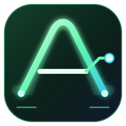
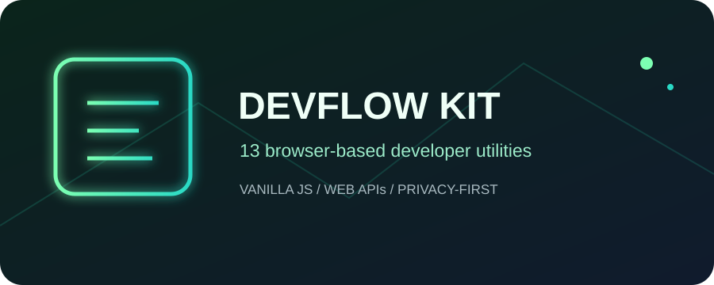
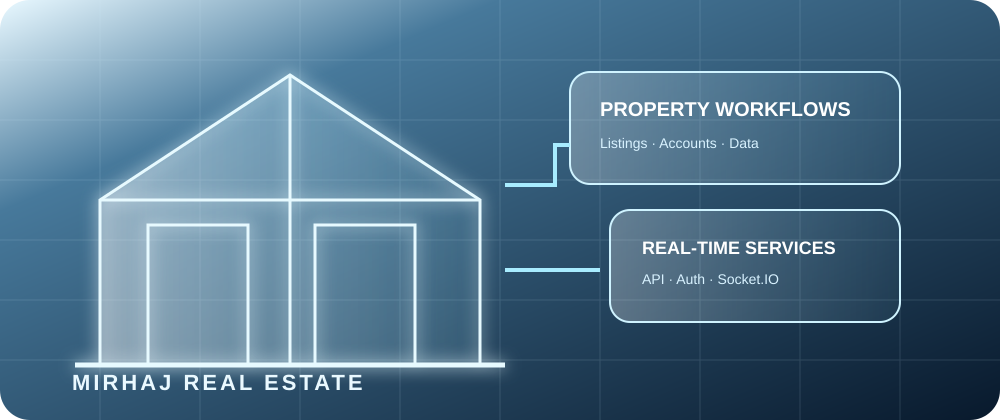
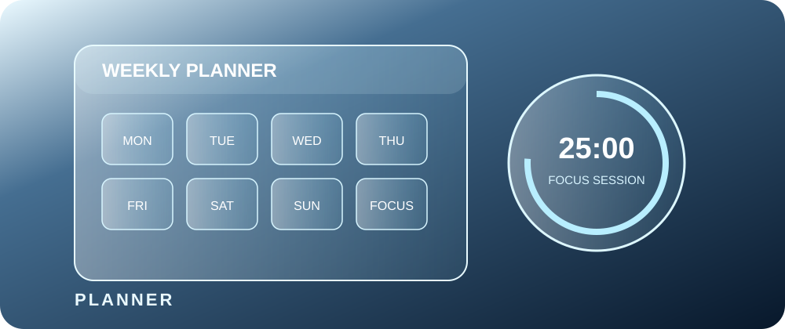
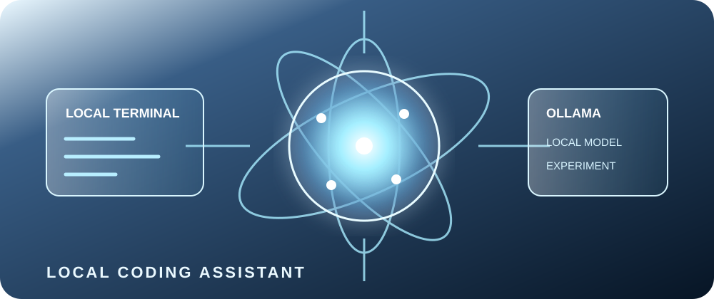

<!--
  AMIRREZA MIRHAJ — ELECTRIC FOREST PROFILE
  Palette: midnight forest #071711 / deep green #0B211B / electric mint #7AFFBD / cyan #32E2C1
  Local artwork is stored in this repository to avoid fragile external image dependencies.
-->

<div align="center">





# Amirreza Mirhaj

### Software Development · Workflow Automation · Applied AI

I build useful software, connect systems, and explore practical applications of AI — learning through implementation, testing, and iteration.

<p>
  <a href="https://github.com/amirreza91-13"></a>
  <a href="https://www.linkedin.com/in/amirreza-mirhaj-490250435/"></a>
  <a href="https://x.com/amirrezaPG"></a>
  <a href="https://t.me/amirrezamirhaj"></a>
  <a href="mailto:amirreza.91mirhaj@gmail.com"></a>
</p>

</div>

---

## ◈ What I work on

- **Software development** — browser-based tools and practical web applications.
- **Workflow automation** — connecting services, APIs, and repeatable processes.
- **Applied AI** — experimenting with model APIs, local models, and AI-assisted developer workflows.
- **Engineering foundations** — improving architecture, testing, debugging, documentation, and maintainability.

I aim to make projects understandable and useful. I separate implemented functionality from planned work, and document project status in each repository.

## ⚡ Featured builds

<table>
  <tr>
    <td width="50%" valign="top">
      <h3><a href="https://github.com/amirreza91-13/devflow-kit">01 / DevFlow Kit</a></h3>
      <a href="https://github.com/amirreza91-13/devflow-kit"></a>
      <p>A privacy-first collection of browser-based developer utilities for JSON, encoding, debugging, and everyday web development tasks.</p>
      <p><sub><strong>Built with</strong><br/>JavaScript · HTML · CSS · Web APIs · Web Workers</sub></p>
      <a href="https://github.com/amirreza91-13/devflow-kit/actions">CI & workflows</a> · <a href="https://github.com/amirreza91-13/devflow-kit">Repository</a>
    </td>
    <td width="50%" valign="top">
      <h3><a href="https://github.com/amirreza91-13/mirhaj-realestate">02 / Mirhaj Real Estate</a></h3>
      <a href="https://github.com/amirreza91-13/mirhaj-realestate"></a>
      <p>A real-estate web application exploring property workflows, server-side routes, authentication, data persistence, and real-time features.</p>
      <p><sub><strong>Built with</strong><br/>Node.js · Express · JavaScript · Socket.IO · sql.js</sub></p>
      <a href="https://github.com/amirreza91-13/mirhaj-realestate">Repository & documentation</a>
    </td>
  </tr>
  <tr>
    <td width="50%" valign="top">
      <h3><a href="https://github.com/amirreza91-13/planner">03 / Planner</a></h3>
      <a href="https://github.com/amirreza91-13/planner"></a>
      <p>A bilingual Persian/English planning application for tasks, habits, calendar, notes, focus sessions, and personal organization. Backend integration is an active development area.</p>
      <p><sub><strong>Built with</strong><br/>React · TypeScript · Vite · Django · SQLite</sub></p>
      <a href="https://github.com/amirreza91-13/planner">Repository & current status</a>
    </td>
    <td width="50%" valign="top">
      <h3><a href="https://github.com/amirreza91-13/Local-Coding-Assistant">04 / Local Coding Assistant</a></h3>
      <a href="https://github.com/amirreza91-13/Local-Coding-Assistant"></a>
      <p>An experimental Python coding assistant with terminal and Streamlit interfaces, using Ollama to connect with locally hosted language models.</p>
      <p><sub><strong>Built with</strong><br/>Python · Streamlit · Ollama · LangChain</sub></p>
      <a href="https://github.com/amirreza91-13/Local-Coding-Assistant">Repository & limitations</a>
    </td>
  </tr>
</table>

## ⟡ Technology constellation

The icons below represent tools and technologies I use, have explored, or am actively learning. They do not imply equal proficiency.

### Languages & web fundamentals

<p>
  
</p>

### Frameworks, runtime & data

<p>
  
</p>

### Engineering workflow

<p>
  
</p>

### AI, models & automation

<p>
  <a href="https://n8n.io/"></a>
  <a href="https://ollama.com/"></a>
  <a href="https://openrouter.ai/"></a>
  <a href="https://lmstudio.ai/"></a>
  <a href="https://www.anthropic.com/claude-code"></a>
  <a href="https://openai.com/codex/"></a>
  <a href="https://opencode.ai/"></a>
</p>

## ⟢ Current engineering direction

```text
Software Engineering
        │
        ├── Programming & web fundamentals
        │
        ├── APIs, backend & data
        │
        ├── Testing, debugging & automation
        │
        └── Practical AI → Agents → AI Engineering
```

My current priorities are stronger software fundamentals, reliable integrations, maintainable code, and practical AI applications.

## ⌁ Explore

<p>
  <a href="https://github.com/amirreza91-13?tab=repositories"></a>
  <a href="https://github.com/amirreza91-13?tab=overview"></a>
</p>

---

<div align="center">

### CONNECT / COLLABORATE

<a href="mailto:amirreza.91mirhaj@gmail.com"></a>
<a href="https://t.me/amirrezamirhaj"></a>
<a href="https://www.linkedin.com/in/amirreza-mirhaj-490250435/"></a>
<a href="https://x.com/amirrezaPG"></a>

<br/><br/>
<sub>ENGINEER WITH CURIOSITY · BUILD WITH INTENT · IMPROVE CONTINUOUSLY</sub>

</div>
