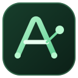

<!-- Profile README · forest-green visual system -->

  

<h1 align="center">Amirreza Mirhaj</h1>

  <strong>Software Development · Workflow Automation · AI Exploration</strong> 
  Building practical software, connecting APIs, and turning repeatable tasks into workflows.

  
  
  

  

---

## About

I'm an independent developer learning by building practical software, integrating APIs, and creating workflow automations. I focus on strengthening the fundamentals, documenting what I learn, and improving projects through iterative implementation.

- **Current focus:** Software development, API integration, and workflow automation.
- **Hands-on automation:** n8n workflows, including form-to-Google-Sheets integrations.
- **AI exploration:** Model APIs, local LLM tools, and AI-assisted development.
- **Long-term direction:** AI Engineering.

> I aim to describe projects by what the code currently supports—not by what I eventually want them to become.

## Selected Projects

These are selected public projects, not a complete list of everything I'm learning or building.

<table>
  <tr>
    <td width="50%" valign="top">
      <h3><a href="https://github.com/amirreza91-13/planner">Planner</a></h3>
      A bilingual personal-planning web app under development.
        
      <strong>Stack</strong> · React · TypeScript · Vite · Django · SQLite
       
      <strong>Focus</strong> · Planner UX, frontend architecture, backend integration
    </td>
    <td width="50%" valign="top">
      <h3><a href="https://github.com/amirreza91-13/Local-Coding-Assistant">Local Coding Assistant</a></h3>
      An experimental coding assistant built around locally hosted language models.
        
      <strong>Stack</strong> · Python · Ollama · Streamlit
       
      <strong>Focus</strong> · Local inference integration; end-to-end runtime validation remains in progress
    </td>
  </tr>
  <tr>
    <td width="50%" valign="top">
      <h3><a href="https://github.com/amirreza91-13/deepseek-api-kit">DeepSeek API Kit</a></h3>
      A Python project exploring model API integration through a proxy service and a separate chat application.
        
      <strong>Stack</strong> · Python · FastAPI · REST APIs
       
      <strong>Focus</strong> · API compatibility, service integration, chat workflows
    </td>
    <td width="50%" valign="top">
      <h3><a href="https://github.com/amirreza91-13/mirhaj-realestate">Mirhaj Real Estate</a></h3>
      A real-estate-oriented web application with server-side routes and property-related workflows.
        
      <strong>Stack</strong> · Node.js · Express · JavaScript · Socket.IO · sql.js
       
      <strong>Focus</strong> · Web application structure, access control, and security hardening
    </td>
  </tr>
</table>

## Technical Toolkit

  <strong>Languages</strong> 
  

  <strong>Web & APIs</strong> 
  

  <strong>Developer Tools</strong> 
  

| Area | Current work |
|---|---|
| Application development | Frontend/backend structure, debugging, iterative improvements |
| API integration | REST endpoints, request formats, JSON data handling |
| Data & ML foundations | pandas, Jupyter, scikit-learn fundamentals, regression and evaluation |
| Workflow automation | n8n service connections, structured data flows, repeatable processes |
| AI tooling | Model-provider APIs, local-model experiments, prompt/context organization, tool integration |

My experience differs by technology. Some items represent hands-on project work; others are active learning areas rather than claims of advanced proficiency.

## Workflow Automation & AI

I use n8n to explore service integrations and reduce repetitive manual work. Current experience includes form-to-Google-Sheets workflows, connecting steps, and experimenting with API-based data flows.

I'm also exploring model APIs, OpenRouter, local model tools such as Ollama and Jan AI, AI-assisted coding, and agent-style tool integration. These areas remain an evolving learning path; I don't present every experiment as a finished system.

## Learning Roadmap

  <strong>Software Fundamentals</strong> → <strong>API Integration</strong> → <strong>Workflow Automation</strong> → <strong>AI Applications</strong> → <strong>Agents & ML</strong> → <strong>AI Engineering</strong>

Current priorities:

1. Strengthen Python and software engineering fundamentals.
2. Improve API integration, debugging, and reliability.
3. Build more robust n8n workflows.
4. Develop practical AI-powered applications.
5. Explore agent architectures and model-tool integration.
6. Build a stronger machine-learning foundation.

## GitHub Activity

  
  

Cards depend on an external service and may be delayed or unavailable. Language breakdowns describe public repository contents—not overall skill level.

## Connect

  <a href="https://www.linkedin.com/in/amirreza-mirhaj-490250435/">LinkedIn</a>
  &nbsp; · &nbsp;
  <a href="mailto:amirreza.91mirhaj@gmail.com">Email</a>
  &nbsp; · &nbsp;
  <a href="https://github.com/amirreza91-13">GitHub</a>

---

Build deliberately. Learn continuously. Improve one iteration at a time.

